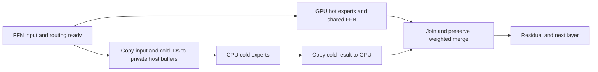

# Option-B graph/scheduler overlap experiment

This continues the graph work in [the handoff](handoff-2026-10-03-option-b-global-pool.md).
The BF16 experiment is set aside. This experiment keeps Q2_0 arithmetic and
static expert placement fixed and changes branch scheduling.

## Current serialization

The Q2_0 cov80 `0/44/4` full decode graph has 98 backend splits. The GGML
scheduler submits those splits in sequence; its CPU backend executes the
CPU graph before returning. When the CPU input copy cannot run asynchronously,
the scheduler synchronizes the producing backend. GPU/CPU branches in a
single expression therefore do not by themselves give concurrent execution.

The Option-B hot GPU and cold CPU FFNs share their input and route decisions.
They become independent after those values are ready. The shared GPU FFN
also uses the same FFN input and does not depend on the routed result.



## Scheduling choices to measure

1. **CUDA graph host callback:** native graph dependencies fork GPU work and
   D2H/CPU/H2D work; the merge waits for both. This can keep the full layer in
   one captured CUDA graph. CPU work runs on a CUDA driver callback thread.
2. **Main-thread CPU work with an early-ready event:** submit the GPU branch
   and input copies, wait only for the input-copy event, run the existing CPU
   graph from the main thread, then enqueue its H2D result and merge. This
   avoids callback execution costs but needs host scheduling between phases.

Both approaches need an explicit join. A full-backend synchronization before
CPU work would remove the desired overlap.

## Standalone laboratory

[`bench/option_b_overlap_spike.cu`](../bench/option_b_overlap_spike.cu) uses:

- Actual GGML Q2_0 routed gate/up -> SwiGLU -> down operations, D=2560,
  FF=640, top-k=10. Hot experts stay on GPU and cold experts stay in DDR.
- The real Layer-13 shared-expert signature from the Q2 checkpoint:
  Q4_K gate, Q3_K up, Q2_0 down, BF16 shared-gate weight. Its kernel path is
  held constant; the BF16 cuBLAS experiment is disabled.
- Rotating route IDs, changing input values, negative IDs for inactive routes,
  and every cold-route count from 0 through 10.
- Six order-balanced pairs of 128 measured replays per cold-count case.
  Both controls use identical kernels and buffers; only dependency ordering
  differs. Serial/fork output vectors must match byte for byte.
- Per-replay checks that CPU input/IDs belong to the current iteration,
  callback completion matches the current sequence, and output is finite.
  Reference hashes also permit comparing callback/main-thread processes.
- A pinned 10-thread GGML CPU pool, restored main-thread affinity after pool
  creation, and blocking CUDA waits. Callback and main-thread modes run in
  separate processes so two OpenMP teams do not spin against each other.

The GPU FFN graph is harvested through the existing integration GGML bridge
and inserted into native CUDA parent graphs. Copies and host work use private
buffers. No expert weights are transferred per replay.

The timing includes a final result readback for validation. It excludes the
router, attention, HC, KV/GDN state and the rest of the model. The callback
serial control also uses a callback, unlike production's ordinary GGML CPU
split, so its improvement cannot be treated as a model throughput gain.

The final guarded run used separate processes for the two scheduling modes,
with continuous CPU/GPU interference checks. No competing jobs were detected.
All 8,448 serial/fork output comparisons per mode were byte-identical. The
reference hashes also matched between the callback and main-thread processes
for all 11 cold-route counts.

Representative main-thread results with the shared GPU expert included:

| Cold experts out of 10 | Serial stage | Early-ready overlap | Stage reduction | Paired wins |
| --- | ---: | ---: | ---: | ---: |
| 0 | 119.94 µs | 78.69 µs | 34.4% | 6/6 |
| 1 | 243.83 µs | 186.58 µs | 23.5% | 6/6 |
| 2 | 320.62 µs | 263.22 µs | 17.9% | 6/6 |
| 4 | 495.21 µs | 434.30 µs | 12.3% | 6/6 |
| 10 | 968.13 µs | 898.59 µs | 7.2% | 6/6 |

The callback overlap path was close in the common cases: 187.75 µs with one
cold expert and 265.50 µs with two. Prefer main-thread early-ready scheduling
for the first engine proof: it keeps CPU execution in the normal scheduler
and avoids adding host nodes to the captured GPU graph. A host callback is
still a measured alternative, rather than an assumed requirement.

Logs and admission checks:
`logs/option_b_overlap_q2_shared1_mode{0,1}_guarded_20261004.{log,admission.json}`.
The aggregate data and actual 0/44/4 cold-route histogram are in
`logs/option_b_overlap_q2_summary_20261004.json`. The GPU branch is about
50 µs in the common cases; over 44 split layers this suggests roughly 2 ms
of hideable work per token. This is a laboratory headroom estimate. It is not
an observed model speedup and excludes integration costs.

Compile against the integration GGML:

```bash
/opt/cuda/bin/nvcc -std=c++17 -O3 -arch=sm_86 \
  -I../llama.cpp-moestream-integration/ggml/include \
  bench/option_b_overlap_spike.cu \
  -L../moestream-build-upstream-master/ggml-build/src \
  -L../moestream-build-upstream-master/ggml-build/src/ggml-cuda \
  -Xlinker -rpath -Xlinker "$PWD/../moestream-build-upstream-master/ggml-build/src" \
  -Xlinker -rpath -Xlinker "$PWD/../moestream-build-upstream-master/ggml-build/src/ggml-cuda" \
  -lggml-cpu -lggml-cuda -lggml-base -o /tmp/option_b_overlap_spike
# arguments: iterations, CPU threads, repetitions, shared FFN (0/1), main-thread mode (0/1)
CUDA_VISIBLE_DEVICES=0 GGML_CUDA_BF16_MMVF_CUBLAS=0 /tmp/option_b_overlap_spike 128 10 6 1 0
CUDA_VISIBLE_DEVICES=0 GGML_CUDA_BF16_MMVF_CUBLAS=0 /tmp/option_b_overlap_spike 128 10 6 1 1
```

## Engine integration requirements

Start with an opt-in Layer-13 proof before extending to all split layers.
Keep the hot mask, IDs, weights, expert types and weighted-reduction order.

GGML's allocator can reuse GPU and CPU scratch across splits. Removing the
existing scheduler waits without changing ownership would permit an overwrite
while another branch still reads the buffer. The overlap bridge must own its
input/ID/result buffers and tie their lifetime to completion, not submission.

For a callback on a side stream, snapshot GPU input/IDs into private device
buffers on the producer stream before returning from the start marker. A
private D2H branch can then continue while GPU scratch is reused. The join
must wait for CPU completion and the result H2D before the merge consumes it.

For main-thread execution, put the D2H input-copy and ready event at the fork
point, before the hot/shared GPU work. The CPU split may wait on that earlier
event only if its private input storage and the scratch reuse rules make it
safe. Preserve the normal merge ordering and the next-layer dependency.

The existing whole-layer host callback must not take over an Option-B split:
it would compute hot routes on CPU too. Also, `run_strided_*_down` currently
rejects negative IDs. Use a prepared cold-only GGML graph with the existing
negative-skip contract, or compact and scatter cold routes explicitly; do
not relax the generic runner's validation across its other execution paths.

Before adoption, compare a one-layer integration against the unchanged
baseline on identical token histories, inspect free-running output, and then
measure six interleaved full-model runs. Laboratory stage percentages are
not the user's throughput acceptance result.

## Opt-in Layer-13 engine proof

The engine now has `ZEROMOE_QWEN_EARLY_READY_LAYER13=1` for single-token
full-graph decode in the ordinary (non-Phase-2) Option-B split path. It is off
by default and currently requires the scheduler bridge in
[`patches/ggml-scheduler-early-ready-layer13.patch`](../patches/ggml-scheduler-early-ready-layer13.patch).
This patch is already applied to `../llama.cpp-moestream-integration`; it
preserves that checkout's existing scheduler profiler changes. It uses the
existing CUDA CPY-marker hook; no additional CUDA backend patch is required.

[`include/qwen4exp_early_ready.hpp`](../include/qwen4exp_early_ready.hpp) owns
pinned input/IDs/weights/position/output, private CPU intermediates and a small
GPU input snapshot. It aliases the original read-only CPU expert planes with
their actual strides. The prepared graph repeats the original cold remap,
mask, separate gate/up, SwiGLU, down and weighting operations. The outer
scheduler owns neither its input storage nor its intermediates.

The producer-stream marker snapshots FFN input, copies input and routing to
pins and records an early event. GPU hot and shared work are explicitly
expanded before the CPU marker. The scheduler hook recognizes only the
private CPU marker and view nodes, with no scheduler inputs; it waits on the
early event and runs the prepared cold graph on the main thread using the
existing CPU backend/pool. Ordinary splits retain all allocator barriers.
The usual GGML CPU-to-GPU copy and weighted merge provide the initial join.
A separate asynchronous output-copy stream remains future work.

The event must be recorded differently during CUDA stream capture:
`cudaEventRecordWithFlags(..., cudaEventRecordExternal)` produces an event
node the host can wait on. Outside capture, use `cudaEventRecord`; the
external flag is rejected in that state. The first two integration attempts
caught these mistakes with assertions. The corrected run handles both normal
execution and captured replay. Failed-attempt timing is excluded.

Each replay checks the copied token position, valid original route IDs,
finite route weights and finite cold output, and rejects duplicate CPU
execution. `gpu_pending` counts replays where the producing GPU stream still
has work after the input-ready wait. The proof rejects layer-timing eval
callbacks; it must not execute a nested CPU graph from inside a MAP_CUSTOM
worker callback.

Validation on Q2_0 / RTX 3090, with BF16 cuBLAS disabled:

- `gguf_tool verify` passed; log:
  `logs/option_b_early_ready_model_verify_20261004.log`.
- The fixed 64-token history produced byte-identical raw logits for all
  records, including prefill. KL, TV and maximum logit delta were all zero.
  Results: `logs/option_b_early_ready_logits_v5_20261004/comparison.json`.
- Free-running 64-token output matched token for token and was inspected:
  a coherent explanation of neural networks. Logs:
  `logs/option_b_early_ready_free_20261004/`.
- The correctness run's first 32 decode replays used the early hook 32 times;
  the GPU stream was still pending at CPU start on 18 of them. This confirms
  actual concurrent scheduling, not just an expression with two branches.

Reproduce a fixed-history check after verifying the checkpoint:

```bash
python3 bench/option_b_early_ready_check.py \
  --engine ../moestream-build-upstream-master/moestream \
  --out-dir logs/early-ready-new-run \
  --prompt-ids logs/quant_decode_compare_chat_20261004/prompt.tokens \
  --continuation logs/quant_decode_compare_chat_20261004/Q2.tokens \
  --reps 1 --dump-logits
```

Use `--free-running` without `--dump-logits` for text inspection; use
`--reps 6` without either for balanced performance measurement. Dumps affect
timing and are not performance evidence. Both arms use the same right-sized
8,421-expert `0/44/4` configuration and differ only in the early-ready flag.
The benchmark excludes initial loop steps 0-2 and checks the contiguous
measurement sequence; this engine does not emit a timing row for the terminal
token. All remaining timing rows are compared on the same history.

The required native suite passed with
`CUDA_VISIBLE_DEVICES=0 make test BUILD_DIR=../moestream-build-upstream-master JOBS=4`;
log: `logs/option_b_early_ready_native_test_20261004.log`.
The first six-pair timing attempt was stopped when another engine job appeared;
that incomplete batch is excluded from throughput conclusions. The benchmark
now checks competing inference/test/compiler processes every second throughout
each process, and records any interference in its manifest. `--wait-idle 300`
can wait for those processes before admission; detected mid-run contention
invalidates the run.

## Extension to all split layers

`ZEROMOE_QWEN_EARLY_READY_ALL_SPLIT=1` extends the same bridge to every
planned split layer in single-token, ordinary full-graph decode. Each layer
owns its own private buffers and ready event and borrows the same CPU
backend/threadpool. The four plain-CPU layers in the cov80 layout retain their
original path. This flag and the Layer-13 flag remain off by default.

The all-split extension passed a new fixed-history comparison: all 64 raw
logit records were byte-identical to the same binary with both flags off.
KL, TV and maximum logit delta were zero. All 44 layers reported 32 early CPU
executions at the diagnostic boundary, with GPU work still pending on
1,379 of 1,408 layer visits. Every actual replay also checked its position
stamp and finite cold output. Results:
`logs/option_b_early_ready_all_logits_20261004/comparison.json`.

The cold result's F32 weighting now runs in the prepared CPU graph, where the
original expression weights it on GPU. The multiply and subsequent merge
order are preserved; the fixed-history bitwise comparison covers this
change too. CPU remap/mask/weight nodes and output validation have costs that
must be included in engine timing. A laboratory estimate alone is insufficient
for adopting the bridge.

Add `--all-split` to the benchmark command to test this extension. The explicit
`--allow-busy-correctness` option requires logit dumps, records any host
interference and marks the timing invalid. It allows numerical validation
while unrelated work proceeds; its throughput is excluded from acceptance.

The full native suite passed again after the all-split extension, using the
same `make test` command above. Log:
`logs/option_b_early_ready_all_native_test_20261004.log`.

The all-split free-running check also matched all 64 generated token IDs to
baseline; its neural-network explanation was inspected and coherent. Logs:
`logs/option_b_early_ready_all_free_20261004/`. Its dump timings are invalid
for performance claims. The Layer-13 timing pilot retained five clean pairs
(mean 31.52 versus 31.46 tok/s); repeated host activity prevented the sixth
pair from completing cleanly. Treat that pilot as essentially flat, not an
acceptance result. The all-split extension provides a larger scheduling change
for a fresh six-pair guarded comparison.

## Completed timing and pause point

The guarded all-split benchmark completed all six order-balanced pairs: baseline 31.754 tok/s, early-ready 32.478 tok/s (+2.28%), with 6/6 paired wins. Dump I/O was disabled and the BF16 experiment remained off. Runs invalidated by concurrent inference/tests were discarded and retried; successful runs were retained with matching binary/config/history hashes.

Results and audit: `logs/option_b_early_ready_all_perf_20261004/summary.json`, `results.json`, `manifest.json`; discarded run files remain in its `discarded/` directory. Resume log: `logs/option_b_early_ready_all_perf_resume_20261004.log`.

Paused at the user's request after the benchmark returned. All source, test scripts, generated files, logs and comparisons are preserved. Both early-ready flags remain off by default; nothing was committed. The integration GGML scheduler patch remains applied and is saved in `patches/ggml-scheduler-early-ready-layer13.patch`. Resume by reviewing the completed six-pair result and deciding the next validation/adoption scope; do not rerun already completed checks without a new change or unresolved concern.
